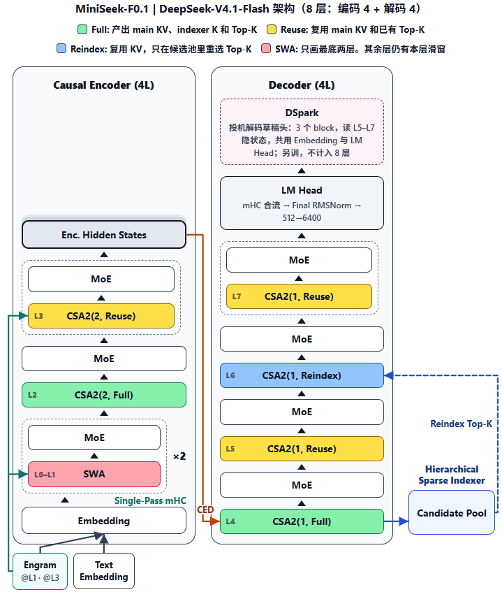

<div align="center">

# MiniSeek

**单卡 3090 从零训练的 DeepSeek-V4.1-Flash 全架构超小模型**

[](https://github.com/wyf-yfw/miniseek/stargazers)
[](LICENSE)
[](https://github.com/wyf-yfw/miniseek/commits/main)
[](https://github.com/wyf-yfw/miniseek/pulls)
[](https://huggingface.co/collections/wyf-yfw/miniseek-6adc765159d38ab3236c49af)

中文 | [English](./README_en.md)

</div>

* 此开源项目用 PyTorch 原生代码，在单张 RTX 3090 上从 0 训练 **MiniSeek-F0.1**：层实现对齐 [DeepSeek-V4.1-Flash](https://arxiv.org/abs/2609.19969) 的超小语言模型，主干 + Engram 共 **187M** 参数，每个 token 只激活约 **33M**。
* 层数、宽度、专家个数按 3090 的预算缩小，层内算子一个不换：CED 因果编码-解码、SWA + CSA2（Full / Reuse / Reindex）压缩稀疏注意力与分层稀疏索引、Single-Pass mHC 多流残差、sqrt-softplus 路由的 MoE、Engram n-gram 记忆、DSpark 投机解码草稿头。
* 训练配方也按论文来：Muon（混合 Newton–Schulz）+ AdamW + Sinkhorn 动量的分组优化、样本级注意力掩码、indexer KL 损失、无辅助损失的专家 bias 均衡。
* 推理侧实现了 KV 缓存、CED 预填充、前缀缓存与有界重放，以及按置信度调度、输出分布与主干一致的 DSpark 投机解码。
* 核心算子（RoPE、稀疏注意力、mHC、路由、Engram 哈希等）都移植了 DeepSeek 官方推理代码做等价测试；带缓存生成与整段前向、投机解码与普通解码也做了端到端一致性校验。
* 数据清洗、预训练、SFT、评测、对话都能在自带的 Web UI 里完成，架构页可以点开任一层查看算子、公式和参数。

> 注：与论文的差异只有三处：KV 与 indexer 全部用 BF16（论文主 KV 为 FP4、滑窗 KV 为 FP8，3090 不支持这两种精度）；暂不含视觉分支；尺寸缩小。

---

<div align="center">



</div>

---

# 📌 项目介绍

DeepSeek-V4.1-Flash 在 Transformer 上加了一整套新部件：编码器算一次、解码器各层复用的全局 KV（CED），三种模式交替的压缩稀疏注意力，4 条残差流的 mHC，哈希查表的 Engram 记忆，一次起草多个 token 的 DSpark。论文和官方代码面向的是数百张卡、FP4 / FP8 内核和数千亿参数，在个人显卡上很难读懂、跑通，更谈不上动手改。

MiniSeek 把这套架构原样缩到一张 3090 能训的尺寸：层数、宽度、专家个数可以小，层内每个算子都按论文和官方代码实现，不拿常见的替代品顶替。在一台机器上就能完整走一遍「数据清洗 → 预训练 → SFT → 草稿头训练 → 推理与投机解码 → 评测」，对照代码和单测看清每个部件在做什么。

#### 🎉 本项目包含以下内容

- MiniSeek-F 全部结构代码（`algo/model/v41/`）：SWA / CSA2 注意力、压缩器、indexer 与候选池、Single-Pass mHC、MoE、Engram、CED 主干、KV 缓存与前缀缓存、DSpark。
- 优化器（`algo/optim/`）：Muon、Sinkhorn 动量，以及按 V4 规则把参数分到 Muon / AdamW / Sinkhorn 三组。
- 训练脚本：预训练 `algo/train_pretrain.py`、SFT `algo/train_sft.py`、DSpark `algo/train_dspark.py` 与置信度校准 `algo/dspark_calibrate.py`；支持断点续训、pack 组批与样本级注意力掩码、从训练集按比例抽验证集。
- 官方推理代码的移植（`tests/v41_ref/`）与逐算子等价测试（`tests/test_v41_*.py`）。
- Web UI（FastAPI，`:7860`）：训练 Task、对话、续写、架构图、评测（C-Eval / CMMLU / GSM8K）、数据清洗、专家负载。
- 一条 Dense 小模型线 `DenseLM`（MiniSeek-D0.1），权重已开源。

#### 🎉 已发布模型列表

| 模型 | 参数量 | 说明 | Release |
|------|--------|------|---------|
| MiniSeek-F0.1 | 187M-A33M（DSpark 另 19M） | DeepSeek-V4.1-Flash 全架构 | 待发布 |
| [MiniSeek-D0.1](https://huggingface.co/wyf-yfw/MiniSeek-D0.1) | 31.73M | Dense SFT / 对话 | 2026-10 |
| [MiniSeek-D0.1-base](https://huggingface.co/wyf-yfw/MiniSeek-D0.1-base) | 28.45M | Dense 预训练基座 | 2026-10 |

---

# 📌 快速开始

<details>
<summary>本人的软硬件配置（供参考）</summary>

* GPU：NVIDIA GeForce RTX 3090（24GB）× 1
* 训练机 Linux，开发机 Windows
* PyTorch ≥ 2.1，其余见 [requirements.txt](./requirements.txt)

</details>

## 第 0 步

```bash
git clone https://github.com/wyf-yfw/miniseek.git
cd miniseek
python -m venv .venv && source .venv/bin/activate   # Windows：.\.venv\Scripts\Activate.ps1
pip install -r requirements.txt

# 词表：MiniMind tokenizer（vocab=6400）
hf download jingyaogong/MiniMind2 --include "tokenizer*" --local-dir ./tokenizer
```

> 旧版 `huggingface_hub` 没有 `hf` 命令时，把 `hf download` 换成 `huggingface-cli download`。也可以用环境变量 `DS41_TOKENIZER_PATH` 指向已有的词表目录。

在 CPU 上先跑一遍单测（含 F0.1 小尺寸的预训练 → SFT 冒烟）：

```bash
python -m pytest tests -q
```

## Ⅰ 🚀 模型推理

### 1' 下载模型

MiniSeek-F0.1 训练完成后发布到 Hugging Face，现在可以先下载 Dense 版：

```bash
hf download wyf-yfw/MiniSeek-D0.1 --local-dir ./hub/MiniSeek-D0.1
```

### 2' CLI 推理

```bash
# 本仓库训练出的任意 checkpoint（F0.1 或 D0.1）
python -m algo.generate --ckpt tasks/f01-sft/last.pt --prompt "你好，请介绍一下你自己。"
```

<details>
<summary>从 Hugging Face 加载 MiniSeek-D0.1（Python）</summary>

```python
import json
from pathlib import Path
import torch
from huggingface_hub import snapshot_download
from safetensors.torch import load_file
from algo.model.config import ModelConfig
from algo.model.dense import DenseLM
from algo.model.tokenizer import load_tokenizer

repo = snapshot_download("wyf-yfw/MiniSeek-D0.1-base")
cfg = ModelConfig.from_dict(json.loads(Path(repo, "config.json").read_text()))
model = DenseLM(cfg)
state = load_file(Path(repo) / "model.safetensors")
model.load_state_dict(state, strict=False)  # base: lm_head tied → tok_emb
tok = load_tokenizer(str(Path(repo) / "tokenizer"))

ids = tok.encode("你好，你是谁", add_special_tokens=True)
out = model.generate(
    torch.tensor([ids]),
    max_new_tokens=64,
    temperature=0.8,
    top_k=50,
    eos_token_id=tok.eos_token_id,
)
print(tok.decode(out[0].tolist(), skip_special_tokens=True))
```

</details>

### 3' Web UI

```bash
MINISEEK_MONOLITH=1 python -m uvicorn api.app:app --host 127.0.0.1 --port 7860
```

`MINISEEK_MONOLITH=1` 让训练、评测和网页跑在同一个进程里（Windows 默认如此）。长期部署用 `deploy/` 下的三个 systemd 单元：训练进程独立在 worker 里，重启网页或 API 不会打断训练。

| 页面 | 作用 |
|------|------|
| 训练 | 建 Task，选 V4.1 / Dense / Tiny，启停、看日志和 Loss 曲线；产物在 `tasks/<id>/` |
| 对话 / 续写 | 加载 checkpoint 对话或续写；F0.1 多轮对话复用前缀缓存，同目录有 `dspark.pt` 时改走 DSpark 投机解码 |
| 架构 | F0.1 架构图（点开每一层看算子、公式、参数）、V4.1-Flash 论文参考图、Dense / Tiny |
| 评测 | C-Eval / CMMLU / GSM8K（lm-eval） |
| 数据清洗 | 预训练 jsonl 的长度 / 语言 / 重复 / 去重 / 敏感词过滤 |
| 专家负载 | 在训练数据上跑路由探针，看 64 个路由专家各被选中多少 |

## Ⅱ 🛠️ 模型训练

### 1' 下载数据

```bash
hf download wyf-yfw/MiniSeek-Pretrain pretrain_mix_12g_clean.jsonl --repo-type dataset --local-dir data/PT
hf download wyf-yfw/MiniSeek-SFT sft_miniseek_v5_short256.jsonl --repo-type dataset --local-dir data/SFT
```

数据组成见下文「数据介绍」。

### 2' 开始训练

> 以下命令在仓库根目录执行；也可以在 Web「训练」页选 V4.1，填同样的参数。

#### 2.1 预训练

```bash
python -m algo.train_pretrain --arch v41 \
  --data data/PT/pretrain_mix_12g_clean.jsonl \
  --out-dir tasks/f01-pretrain \
  --batch-size 8 --valid-ratio 0.01
```

`--arch v41` 默认 `max_seq_len=1024`、峰值学习率 `3e-4`（余弦退火到 `3e-5`）、BF16 自动混合精度、pack 组批加样本级注意力掩码。优化器按 V4 规则分组：矩阵走 Muon，Embedding / LM Head / Engram 表走 Sinkhorn 动量，RMSNorm 与标量走 AdamW。候选池在预训练默认关闭（`--candidate-pool` 可开）。显存不够时加 `--act-ckpt` 按层重计算，或调小 `--batch-size`。

训练后得到 `tasks/f01-pretrain/last.pt`（每 5000 步滚动保存）和 `best.pt`。

#### 2.2 指令微调

```bash
python -m algo.train_sft --arch v41 \
  --init-ckpt tasks/f01-pretrain/last.pt \
  --data data/SFT/sft_miniseek_v5_short256.jsonl \
  --max-seq-len 256 \
  --out-dir tasks/f01-sft
```

SFT 默认打开候选池（论文在后训练阶段才启用分层稀疏索引）和解码器有界重放模拟；超出 `max_seq_len` 的对话从尾部截断，尽量保留问题。`sft_miniseek_v5_short256.jsonl` 适合先验证模型能不能对话；正式长上下文 SFT 换成 `sft_miniseek_v5_10g.jsonl` 和 `--max-seq-len 1024`。

#### 2.3 DSpark 草稿头（可选）

```bash
python -m algo.train_dspark --backbone tasks/f01-sft/last.pt --out-dir tasks/f01-sft
python -m algo.dspark_calibrate --dspark tasks/f01-sft/dspark.pt --data data/PT/pretrain_mix_12g_clean.jsonl
```

主干冻结，只训草稿头，损失为 `0.1·CE + 0.9·TV + 1.0·BCE`；校准把逐位置温度写回 `dspark.pt`。`dspark.pt` 和主干 checkpoint 放在同一目录，网页加载主干时会自动启用投机解码。

#### 2.4 测试模型

```bash
python -m algo.generate --ckpt tasks/f01-sft/last.pt --prompt "你好，请介绍一下你自己。"
python -m algo.eval.valid_ppl --ckpt tasks/f01-pretrain/last.pt --data data/PT/pretrain_mix_12g_clean.jsonl --valid-ratio 0.01
```

<details>
<summary>注：其它须知</summary>

- 断点续训：`--resume <ckpt>`（含优化器状态）。`--max-steps` 是本轮步数上限，续训时进度和学习率日程从 0 起算。
- Checkpoint：默认只保留滚动的 `last.pt` 和最好的 `best.pt`；需要里程碑时再显式加 `--save-loss-thresholds`。
- 验证集：没有独立文件，用 `--valid-ratio` 从训练集里抽，不改动源 jsonl。
- `torch.compile`：v41 默认关闭（MoE 分发与稀疏索引会频繁 graph-break），Dense 默认开启。
- Dense 线：把 `--arch v41` 换成 `--arch dense`（默认 `max_seq_len=512`）。

</details>

---

# 📌 数据介绍

## Ⅰ Tokenizer

沿用 [MiniMind](https://github.com/jingyaogong/minimind) 的词表（vocab=6400）。词表小，Embedding 与 LM Head 各只占 3.3M，参数主要留给注意力和专家。没有本地词表时代码会退回字节级 `FallbackTokenizer`，只能用于冒烟，不能正式训练。

## Ⅱ 预训练 / SFT 数据

| 用途 | 路径 | 说明 |
|------|------|------|
| 预训练 | `data/PT/pretrain_mix_12g_clean.jsonl` | 每行 `{"text": ...}`，中英混合，由 12G 混合语料清洗而来 |
| SFT（正式） | `data/SFT/sft_miniseek_v5_10g.jsonl` | 约 10 GiB / 596 万条对话；另有 5G 子集 `sft_miniseek_v5_5g.jsonl` |
| SFT（快速验证） | `data/SFT/sft_miniseek_v5_short256.jsonl` | 从 10G 中筛出的短对话，约 0.84 GiB / 202 万条 |
| 验证集 | 无独立文件 | 训练和 `valid_ppl` 都用 `--valid-ratio` 从训练集内存抽样 |

Hub：[`MiniSeek-Pretrain`](https://huggingface.co/datasets/wyf-yfw/MiniSeek-Pretrain)、[`MiniSeek-SFT`](https://huggingface.co/datasets/wyf-yfw/MiniSeek-SFT)（含 config `sft_short256`）。来源与配比见 `data/PT/SOURCES.md`、`data/SFT/SOURCES_v5.md`、`data/SFT/SOURCES_v5_short256.md`。

---

# 📌 模型

## 结构

MiniSeek-F0.1 共 8 层：前 4 层是因果编码器，后 4 层是解码器，层内算子与 DeepSeek-V4.1-Flash 一致。

* **注意力**：Q 走低秩（512→128→16×128）；K、V 是同一份 128 维潜向量，所有头共享；只在最后 32 维加 RoPE，输出端再反向旋转；softmax 带每头可学习的 sink；输出分 2 组做低秩投影。每层都有窗口 128 的本层滑窗。
* **CSA2 三种模式**：Full 层用压缩器把序列压成全局 KV（编码器 m=2 两两池化，解码器 m=1），由 indexer 打分选 top-64；Reuse 层复用来源层的全局 KV 和 top-k；Reindex 层复用全局 KV，在候选池里重选 top-k。
* **CED**：编码器输出只在解码器第一层（L4）投影成全局 KV，后面的解码器层全部复用。推理时命中前缀缓存后，只需对最后 128 个 token 做有界重放。
* **分层稀疏索引**：L4 把 indexer 分数按 8 个位置一块取最大，留 32 块作为候选池，L6（Reindex）只在池内重选。预训练关闭，SFT 开启。
* **Single-Pass mHC**：4 条残差流，每个子层用 pre / post / comb 三组系数读写残差，comb 经 20 次 Sinkhorn 归一。
* **MoE**：1 个共享专家 + 64 个路由专家选 top-6，专家是 clamp SwiGLU（中间维 176）；打分 sqrt(softplus)，选专家看分数加 bias，加权用原分数归一后乘 1.5；bias 按负载 ±0.001 更新，另有 1e-4 的序列级均衡损失。
* **Engram**：L1、L3 之前各有一个 2~4-gram 哈希记忆，每条残差流用自己的门控写入。
* **DSpark**：3 个 block 的草稿头读主干 L5–L7 的隐状态，一次起草 5 个 token，按置信度提前停，再由主干一次验证。

逐层排布（每层都是「注意力 + MoE」两个子层，残差走 mHC）：

| 层 | 位置 | 注意力模式 | 压缩比 m | 其它 |
|----|------|-----------|---------|------|
| L0 | 编码器 | SWA | — | 只有滑窗 |
| L1 | 编码器 | SWA | — | Engram |
| L2 | 编码器 | CSA2 Full | 2 | 产出全局 KV、indexer K 与 top-k |
| L3 | 编码器 | CSA2 Reuse | 2 | Engram |
| L4 | 解码器 | CSA2 Full | 1 | CED：由编码器输出投影全局 KV；建候选池 |
| L5 | 解码器 | CSA2 Reuse | 1 | |
| L6 | 解码器 | CSA2 Reindex | 1 | 候选池内重选 top-k |
| L7 | 解码器 | CSA2 Reuse | 1 | |

完整超参见 [`algo/model/v41/config.py`](algo/model/v41/config.py)，设计说明见 [`docs/superpowers/specs/2026-10-29-v41-flash-full-arch-design.md`](docs/superpowers/specs/2026-10-29-v41-flash-full-arch-design.md)。

## 模型配置

| Model Name | params | vocab | max_seq | d_model | n_layers | heads × head_dim | MoE | note |
|------------|--------|-------|---------|---------|----------|------------------|-----|------|
| MiniSeek-F0.1 | 187M-A33M | 6400 | 1024 | 512 | 8（4+4） | 16 × 128（KV 共享） | 1+64，top-6，h=176 | V4.1-Flash 全架构 |
| MiniSeek-D0.1 | 28M | 6400 | 512 | 512 | 8 | 8 × 64 | — | Dense |

187M = 主干 158M + Engram 表 29M；A33M 是每个 token 实际参与计算的主干参数（只算被选中的 6 个路由专家，不含 Engram 表）。DSpark 草稿头另有 19M。

## 与 DeepSeek-V4.1-Flash 的差异

| 项 | DeepSeek-V4.1-Flash | MiniSeek-F0.1 |
|----|---------------------|---------------|
| 层数 | 40（编码 20 + 解码 20） | 8（编码 4 + 解码 4） |
| MoE | 1 共享 + 384 路由，top-6 | 1 共享 + 64 路由，top-6 |
| 参数 | 主干 552B + Engram 196B | 主干 158M + Engram 29M |
| indexer top-k / 候选池 | 512 / 2048 块 × 8 | 64 / 32 块 × 8 |
| KV 精度 | 主 KV FP4，滑窗 KV FP8 | 全部 BF16 |
| 视觉 | 有 | 暂无 |

---

# 📌 评估

所有模型用同一套 Eval-Core：

| # | 项目 | 说明 |
|---|------|------|
| 1 | Valid PPL | 从训练 jsonl 按 `--valid-ratio` 抽样 |
| 2 | Gen-Smoke | 20 条固定 prompt，seed=42 |
| 3 | C-Eval valid | lm-eval |
| 4 | CMMLU | lm-eval（需 `trust_remote_code`；`datasets>=2.14,<4.0`） |
| 5 | GSM8K | lm-eval generate_until |
| 6 | 效率 | 同硬件记峰值显存与 tokens/s |

```bash
python -m algo.eval.valid_ppl --ckpt tasks/f01-pretrain/last.pt --data data/PT/pretrain_mix_12g_clean.jsonl --valid-ratio 0.01
python -m algo.eval.gen_smoke --ckpt tasks/f01-sft/last.pt --seed 42
```

C-Eval / CMMLU / GSM8K 在 Web「评测」页跑，或用 `algo/eval/run_benchmark.py`（见 [`algo/eval/README.md`](algo/eval/README.md)）。F0.1 的结果会在训练完成后补到这里，Dense 线的结果在 `algo/eval/reports/`。

---

# 📌 目录

```text
algo/
├── model/v41/          # MiniSeek-F：config · rope · attention · mhc · moe · engram · model · cache · dspark
├── model/dense.py      # MiniSeek-D：DenseLM
├── optim/              # Muon · Sinkhorn 动量 · 参数分组
├── train_pretrain.py   # 预训练
├── train_sft.py        # SFT
├── train_dspark.py     # DSpark 草稿头
├── dspark_calibrate.py # DSpark 置信度校准（STS）
├── generate.py         # CLI 生成
└── eval/               # Valid PPL · Gen-Smoke · lm-eval
api/                    # FastAPI：训练 Task · 推理 · 架构 · 评测 · worker
frontend/               # Web UI
deploy/                 # systemd 单元（web / api / worker）
scripts/                # 数据检查 · 清洗 · 冒烟
tests/                  # 单测；tests/v41_ref/ 为官方推理代码移植
docs/                   # 设计文档与实现计划
images/                 # README 配图
tasks/                  # 训练产物（不进 Git）
```

---

# 📌 致谢

- 架构与参考实现：[DeepSeek-V4.1 论文](https://arxiv.org/abs/2609.19969) 与 [deepseek-ai/DeepSeek-V4.1-Flash](https://huggingface.co/deepseek-ai/DeepSeek-V4.1-Flash) 的官方推理代码（MIT）
- 词表与 README 版式：[jingyaogong/minimind](https://github.com/jingyaogong/minimind)
- 客观评测：[lm-evaluation-harness](https://github.com/EleutherAI/lm-evaluation-harness)、C-Eval、CMMLU

欢迎 Issue / PR。

---

# 🎓 引用

若本项目对你有帮助，欢迎引用仓库或在论文 / 博客中注明链接：

```bibtex
@misc{miniseek2026,
  title        = {MiniSeek: A Tiny Trainable Reproduction of the DeepSeek-V4.1-Flash Architecture},
  author       = {wyf-yfw},
  year         = {2026},
  howpublished = {\url{https://github.com/wyf-yfw/miniseek}}
}
```

---

# ⚖️ 开源协议

[MIT](LICENSE)
